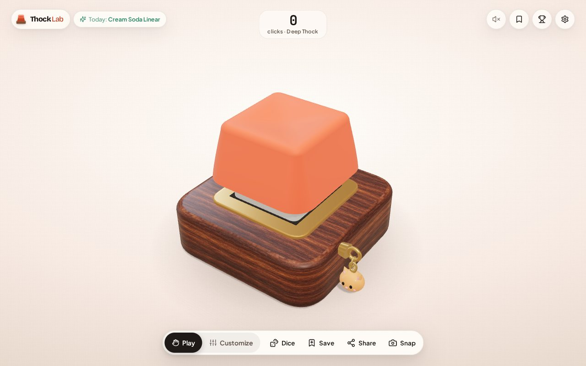
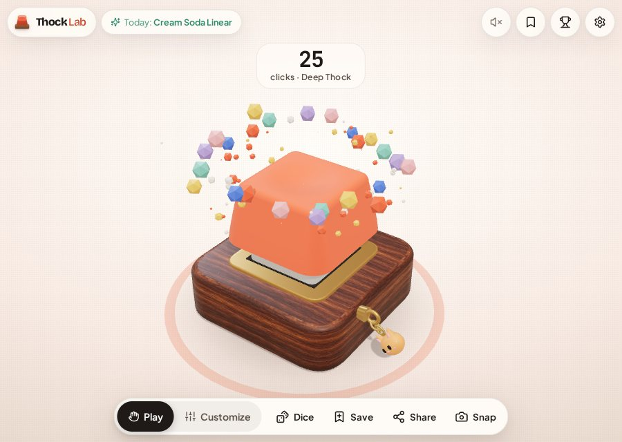
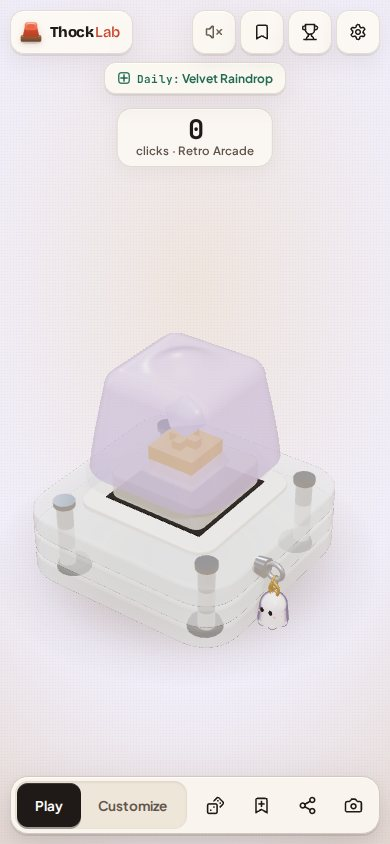
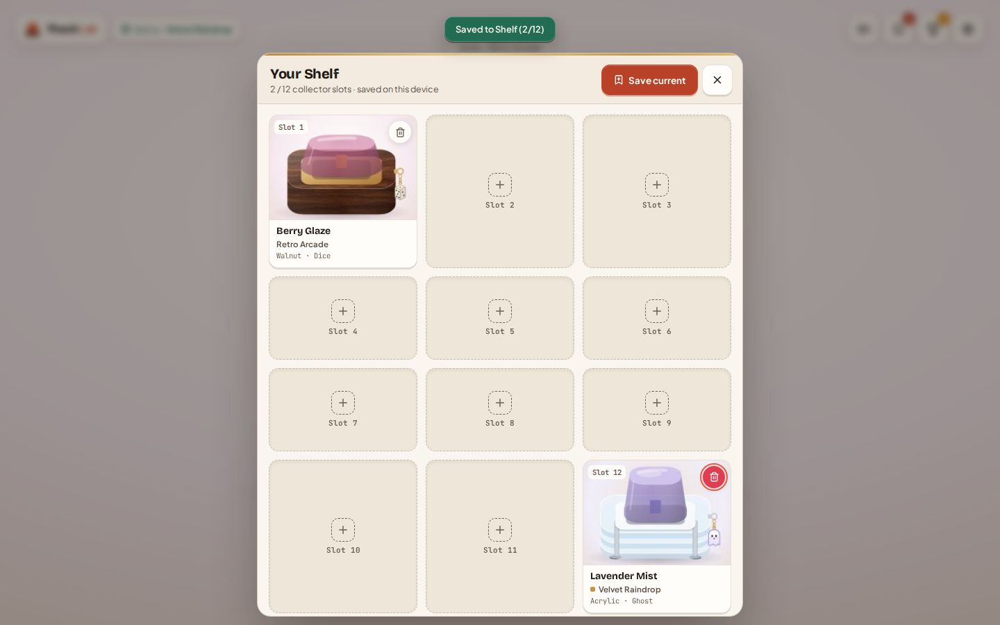
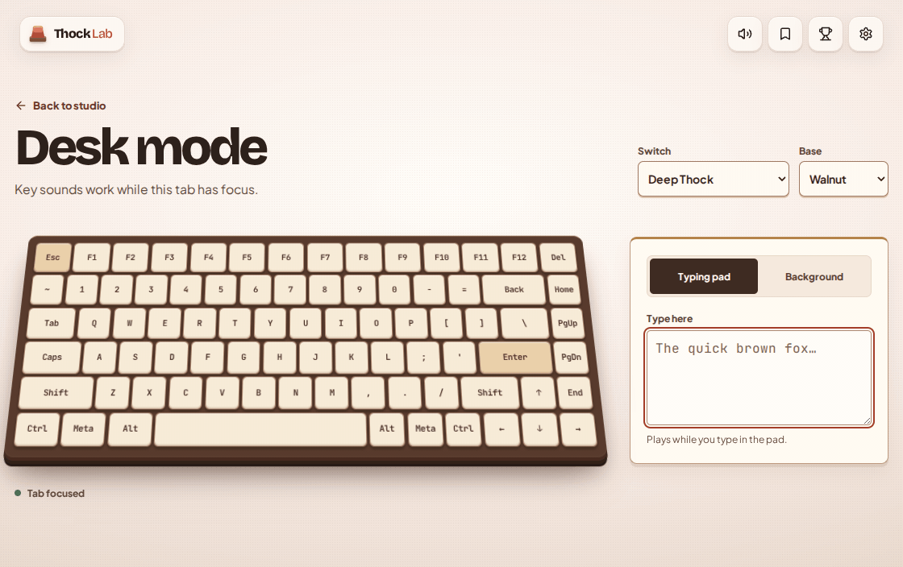

# Thock Lab

Thock Lab is a browser-based workshop for a one-key mechanical clicker. The studio puts the object in your hands first. Press the sculpted keycap to hear the switch bottom out, then let go to hear it spring back as the charm swings. Swap the housing to hear the same switch through walnut, aluminum, acrylic, or plastic, then save the build or send someone a link they can play immediately. Desk mode takes that switch and housing sound across a physical keyboard.

[Play Thock Lab](https://thock.algoty.com/)



| 25-click streak | Frosted acrylic on mobile | Collector Shelf |
| --- | --- | --- |
|  |  |  |

## What you can do

- Press with touch, mouse, Space, or Enter on the focused clicker. Drag to orbit the 3D model and double-click the backdrop to reset the camera. The cap travel, sound, and charm motion make the press the signature interaction.
- Build around six synthesized switch sounds or the rotating Switch of the Day. Change the keycap profile, color, and finish, pick a base and charm, or roll a curated combination.
- Chase 25×, 50×, and 100× streak milestones, collect achievements, and save builds in 12 numbered Shelf slots. A recent Shelf deletion can be undone.
- Share a playable build by URL or export a 1080 × 1080 PNG. The studio has a 2D fallback, reduced motion, and optional haptics on supported devices.

## Desk mode

Open **Desk mode** in the studio dock or under **Settings**. Pick a switch and base, then type in the pad to hear each press and release. Select **Background** to hear keys anywhere in the focused Thock Lab tab. A physical keyboard works on phones and tablets too.



## Architecture

- **Studio** uses Vite, TypeScript, React, and three.js. The 3D scene renders on demand, and the 2D renderer shares the same build and input state.
- **Sound** uses Web Audio to synthesize separate press and release envelopes from oscillators and filtered noise. The studio sounds run in real time. Desk mode pre-renders both phases for the selected build and plays them from Web Audio buffers with per-key pitch and gain.
- **Sharing** uses a versioned URL-fragment codec. The link contains the build, including the selected daily variant. A recipient can open it without an account or a server-side lookup.
- **Storage and offline** use browser-local state for the Shelf, settings, and progress. A service worker precaches the production app so it can open offline after a successful online visit.

## Run locally

With Node.js 22 or newer and npm:

```sh
npm ci --include=dev
npm run dev
```

Open `http://127.0.0.1:6803/`. Use `npm run build` to produce the static app in `dist/`.

## Test

Run `npm run build && npm run preview`, then run these commands in another terminal. Set `BASE_URL` to a deployed HTTPS build to include the WebKit origin-disconnection test. The audio tests need a working audio backend for the headless browsers.

```sh
npx playwright install chromium webkit
env ENGINE=chromium node tests/e2e.mjs
env ENGINE=webkit node tests/e2e.mjs
node tests/share-codec.mjs
node tests/desk-keys.mjs
```

The end-to-end suites cover desktop and iPhone profiles, Desk mode’s cached audio and tab focus, touch and keyboard audio timing, 105 viewport sizes, focus and touch targets, Shelf and sharing flows, real PNG downloads, and offline reload. The standard flows run without WebGL. A separate deterministic SwiftShader run exercises the 3D path and secondary-click handling.

```sh
env ONLY=round5 node tests/webgl-shots.mjs
```

## Known issues

- On a fresh page, touch audio can be gated until the first trusted touch ends. Thock Lab plays the downstroke and then the upstroke at release in that case. Once audio is unlocked, later holds sound on press. [WebKit user activation rules](https://webkit.org/blog/13862/the-user-activation-api/)

MIT licensed. Copyright (c) 2026 Milad Rashidikhah. [License](LICENSE)
